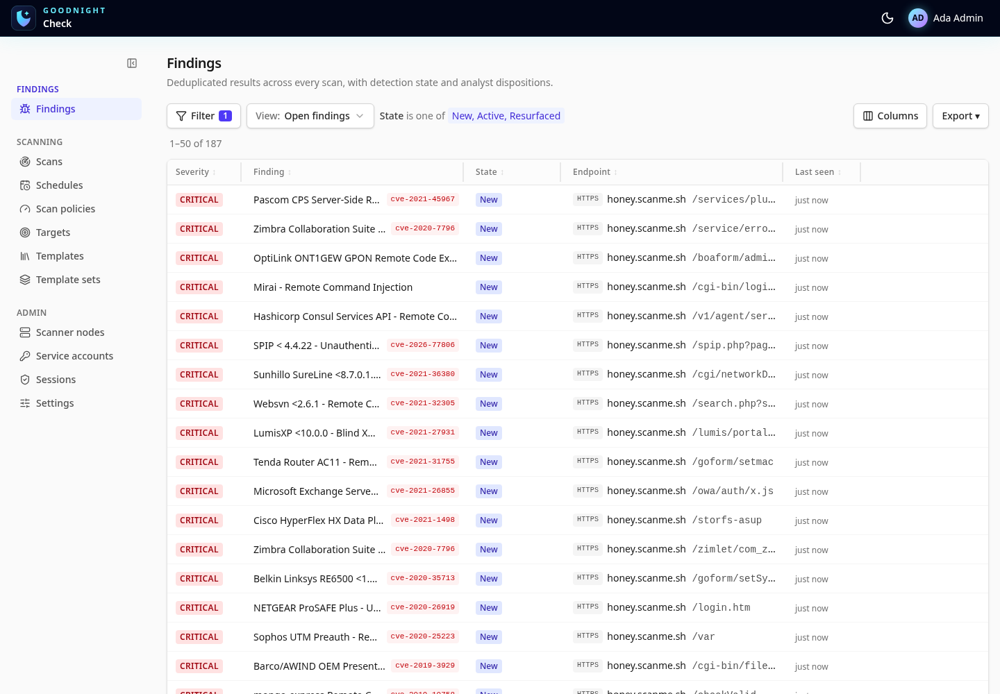

# Goodnight Check

[](https://github.com/goodnightsec/gn-check/actions/workflows/ci.yml)
[](LICENSE)
[](https://github.com/goodnightsec/gn-check/releases)

Goodnight Check is a self-hosted vulnerability scanner for a small security or engineering team.
It runs [Nuclei](https://github.com/projectdiscovery/nuclei) templates against approved targets,
on demand or on a schedule, and keeps the results for triage. It is portable to any cloud.

A logged-in user defines **targets** and **template sets**, runs scans (on demand or on a
**cron schedule**), and triages the results through a **Tenable-style finding lifecycle** —
dedup, evidence-driven detection state (new / active / resurfaced / mitigated), and analyst
dispositions (accept-risk / false-positive / recast). Findings export as JSON / CSV / SARIF /
raw JSONL. Complete scans export/import as versioned scan bundles (JSON or zip). A **scope
guardrail** keeps every scan inside approved targets, every mutating call
is written to a structured **audit log**, and raw scanner output is archived to object storage.

<picture>
  <source media="(prefers-color-scheme: dark)" srcset="docs/assets/gn-check-preview-dark.png">
  
</picture>

*Live application screenshot: populated Findings from a honey.scanme.sh full-catalog scan, in the light or dark theme to match yours.*

## Architecture

Three services, split so the scanner is a disposable, credential-less execution engine:

- **backend** — the system of record. Owns Postgres, runs OIDC/BFF auth, dispatches scans,
  polls the scanner to completion, ingests findings, and serves the API + embedded SPA.
- **scanner node** — runs the `nuclei` binary against a scan spec and serves results over HTTP.
  Holds no database credentials.
- **Postgres** + an **S3-compatible object store** (for the raw-output archive).

```
browser ─▶ React SPA (served by backend at /) ─▶ /api/* (session cookie, roles)
              │
POST /api/scans ─▶ backend ──dispatch──▶ scanner node ──▶ nuclei ──▶ results.jsonl
                    │  ◀────poll/pull──────────┘
                    └─▶ Postgres (scans, findings) + S3 (raw archive)
```

Traffic is strictly backend → scanner. See **[docs/ARCHITECTURE.md](docs/ARCHITECTURE.md)** for
the design rationale.

Both services ship as multi-arch (`linux/amd64` + `linux/arm64`) images on a minimal **Red Hat UBI
10 Micro** base; the scanner is fully self-contained, baking in a checksum-verified, pinned `nuclei`
binary (`NUCLEI_VERSION`) and `naabu`. The backend-owned template catalog is pushed to nodes as a
verified bundle; the image contains no mutable community template cache. See
**[Administration guide → Deployment](docs/admin/Deployment.md)**.

## Quick start

Requires Docker (Go and the SPA both compile inside the build containers).

```sh
cp .env.example .env          # change SCANNER_TOKEN (at least 32 characters —
                              # `openssl rand -base64 24`; shorter crash-loops
                              # the scanner); see the OIDC note below
docker compose up --build
```

The backend image shows `dev` plus this checkout's commit. Leave `VERSION_TAG` unset.
Override the commit with `GIT_COMMIT=$(git rev-parse HEAD) docker compose up --build`
when the tree has no `.git` directory (a linked worktree).

To use a released backend and scanner image instead of building from source, see
**[Administration guide → Run from published images](docs/admin/Deployment.md#run-from-published-images)**
for the GHCR names, tag rules, and how to point this Compose stack at them.

The seeded local Keycloak realm and `.env.example` intentionally contain the same development-only
`OIDC_CLIENT_SECRET`. Either leave that value unchanged locally, or—before the realm is first
imported—change it in both `.env` and `deploy/keycloak/realm-nsc.json` so they still match.

Open **http://localhost:8080** and log in with a demo user (`admin` / `admin`,
`operator` / `operator`, or `viewer` / `viewer`). The compose stack runs backend + UI on `:8080`,
the scanner on `:8081`, plus Postgres, Garage, and a seeded Keycloak IdP. Opening the UI as
`http://127.0.0.1:8080` redirects to `localhost` before login — session cookies and the IdP
callback are host-specific.

> If this binary is older than the database it is pointed at, startup refuses to run: the
> migration history was written by a newer release, so run that release or newer.

## Upgrading from NSC

Goodnight Check is the new name of the product. `v0.5.0` is the first release under the new
name, and every `v0.4.x-beta` installation upgrades to it in place. No migration script is
needed:

1. Point both services at the new images, `ghcr.io/goodnightsec/gn-check-backend` and
   `ghcr.io/goodnightsec/gn-check-scanner`.
2. Upgrade the backend and the scanner together.
3. Keep the database, the bucket and the environment as they are.
4. With the Compose stack from this repository, keep your current Compose project name. The
   project is now named `gn-check`, and Compose names volumes after the project, so without this
   Postgres, Garage and the template cache start with new, empty volumes. `docker volume ls` shows
   your current name as the prefix of `<name>_pgdata`. Set `COMPOSE_PROJECT_NAME=<name>` in
   `.env`, which every later command picks up (`docker compose -p <name>` works too, but only if
   you pass it on every command). Or, with the stack down, copy each volume into its new
   `gn-check_*` volume, for example
   `docker run --rm -v <name>_pgdata:/from -v gn-check_pgdata:/to alpine cp -a /from/. /to/`.

Sessions, service-account tokens, export clients and UI settings keep working, and scan bundles
exported from a `v0.4.x-beta` release still import. Three changes are visible:

- **The image names,** as above.
- **The SARIF tool** is now `gn-check`. GitHub code scanning treats it as a new tool, so alerts
  uploaded under the old name are closed once and reopened under the new one.
- **The mail subject** now starts with `[Goodnight Check]`.

Some technical identifiers keep the old short name `nsc` on purpose, because renaming them would
break installations, clients or stored data: the `nsc_` token prefix, the session cookies, the
`X-NSC-Export-*` headers, the export fields, the `*.nsc-bundle.*` file names, the browser storage
keys and the `/var/lib/nsc` data directory. The default bucket stays `nuclei-raw`.

## Repository layout

```
cmd/backend      backend entrypoint (system of record + orchestrator)
cmd/scanner      scanner node entrypoint (credential-less nuclei runner)
internal/types   wire contracts shared by both services
internal/scanner scanner node: runs nuclei, serves results over HTTP
internal/backend orchestrator, scanner client, HTTP API, OIDC/BFF auth, audit log, scope guardrail
internal/store   Postgres access + embedded migrations
web/             React + TS + Vite SPA (embedded into the backend via go:embed)
deploy/          Dockerfiles, seeded Keycloak realm, local Garage config
docker-compose.yml   postgres + garage + keycloak + scanner + backend
```

## Documentation

- **[Architecture](docs/ARCHITECTURE.md)** — design principles, components, data model, and decisions.
- **[API reference](docs/API.md)** — REST endpoints for scans, findings, dispositions, exports, and schedules.
- **[Administration guide](docs/ADMIN_GUIDE.md)** — deployment, environment variables, authentication, bootstrap, operations, audit, and troubleshooting. Chapters live in [`docs/admin/`](docs/admin/) and are published to the [GitHub wiki](https://github.com/goodnightsec/gn-check/wiki) from `main` and each `v*` tag.
- **[Development](docs/DEVELOPMENT.md)** — local dev workflow, auth-disabled mode, tests, and CI/CD.
- **[UI style guide](docs/UI_STYLE_GUIDE.md)** — design system for the web app: layout, buttons, tables, forms, dialogs, and feedback.
- **[Contributing](CONTRIBUTING.md)** — setup, verification gates, invariants, and PR conventions.
- **[Code of Conduct](CODE_OF_CONDUCT.md)** · **[Security Policy](SECURITY.md)** — community standards; private vulnerability reporting.

## License

Goodnight Check is licensed under the GNU Affero General Public License v3.0 or later
(AGPL-3.0-or-later). Contributions are accepted under the same license, with a DCO sign-off on
every commit; see [Contributing](CONTRIBUTING.md#license-and-sign-off).

Copyright (C) 2026 Goodnight Check contributors

This program is free software: you can redistribute it and/or modify it under
the terms of the GNU Affero General Public License as published by the Free
Software Foundation, either version 3 of the License, or (at your option) any
later version. See [LICENSE](LICENSE) for the complete text.

This program is distributed in the hope that it will be useful, but WITHOUT ANY
WARRANTY; without even the implied warranty of MERCHANTABILITY or FITNESS FOR A
PARTICULAR PURPOSE.

AGPL-3.0 is copyleft, including the network-use clause: anyone running a
modified version as a service must publish the source of their modifications.
(`LICENSE` is the byte-exact canonical FSF text, which is unmodifiable — the
program copyright notice therefore lives here, per the license's own "How to
Apply These Terms" section.)
